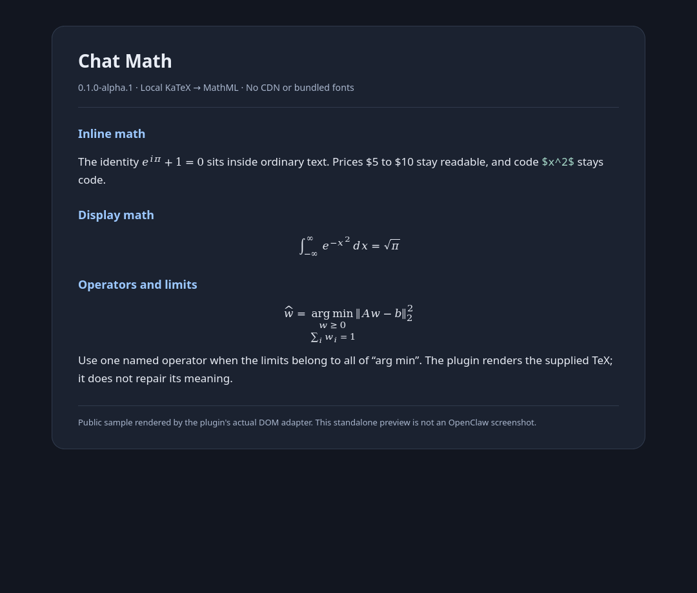

# Chat Math for OpenClaw

**Alpha community plugin** that renders LaTeX formulas in the native OpenClaw Control UI conversation. It is a **math-only adaptation of [OpenClaw Dashboard Extras](https://github.com/Tom-Notch/openclaw-dashboard-extras)**, not an official OpenClaw feature or a wholly original renderer.



*A nonpersonal standalone preview using the plugin's actual DOM adapter, not a screenshot of a private conversation or the OpenClaw application. [Example Markdown](docs/example.md).*

## What it does

- Supports `$...$`, `$$...$$`, `\(...\)` and `\[...\]`.
- Uses bundled KaTeX and DOMPurify to create sanitized native **MathML** locally: no CDN, network rendering service, or bundled math fonts.
- Keeps the native transcript, composer, Markdown copy/reply, links and file previews host-owned.
- Leaves code, conservative price patterns, incomplete formulas and invalid TeX readable.
- Does not register backend tools, RPCs, file actions, OS openers or outbound requests. No core asset patch is required.
- Also accepts standalone multiline `[` / `]` containing TeX commands as a pasted-formula convenience. This is **not standard LaTeX**; prefer explicit delimiters.

## Compatibility and limitations

| Item | Status |
| --- | --- |
| Plugin version | `0.1.0-alpha.1` |
| Verified OpenClaw host | **2026.9.9** |
| Node for source builds | 24.16+ |
| Other OpenClaw versions | Not verified; the Plugin/Control UI API is experimental |
| Math typography | Browser-native MathML and available system math fonts; not KaTeX HTML/font-identical |

The adapter uses the public `mountDefault` composition contract but locates formulas using native transcript DOM selectors (`[data-message-text]` and `.chat-text`). Host UI changes need retesting. It selects its transcript replacement when activated, so do not combine it with another active transcript replacement.

Rendering is bounded (96,000 source characters per message, at most 256 formulas, 20,000 characters per formula, plus expansion/output limits). Content outside these limits stays literal. Math inside links/code is not enhanced. This is a renderer, not a TeX editor: it does not fix mathematical meaning.

The same math adapter was exercised in a real OpenClaw 2026.9.9 conversation during development, including native copy/link behavior. The public alpha adds packaging and documentation; the standalone example is a separate, nonpersonal rendering demonstration.

## Install

### From the GitHub release

Download `openclaw-chat-math-0.1.0-alpha.1.tgz` from the [alpha release](https://github.com/diregoblin/openclaw-chat-math/releases/tag/v0.1.0-alpha.1), and optionally check its SHA-256 against `SHA256SUMS`:

```sh
openclaw plugins install ./openclaw-chat-math-0.1.0-alpha.1.tgz --accept-capabilities
openclaw plugins enable chat-math
```

### From ClawHub

When the alpha is visible in the registry:

```sh
openclaw plugins install clawhub:openclaw-chat-math@0.1.0-alpha.1 --accept-capabilities
openclaw plugins enable chat-math
```

The plugin/package identity is `chat-math` / `openclaw-chat-math`. It is **not published to npm**; use the explicit `clawhub:` prefix or the release archive, not a bare npm package name. `--accept-capabilities` consents to its Control UI transcript replacement: browser-side code reads and decorates displayed message text. You can omit the flag on the first attempt to inspect your host's consent notice.

### Enable custom Control UI plugins

OpenClaw 2026.9.9 requires its experimental custom-plugin switch. If it is not already enabled, set only this key, preserving the rest of your configuration:

```sh
openclaw config set gateway.controlUi.experimental.customPlugins true
```

Then use **Plugins → Advanced → Customize UI** to enable/reload the plugin UI. OpenClaw 2026.9.9 successfully hot-reloaded the development artifact without a Gateway restart. Do not assume other versions behave identically; follow any restart/reload notice your host displays.

Paste a formula outside a code block in the chat, for example:

```latex
\[
\int_{-\infty}^{\infty} e^{-x^2}\,dx = \sqrt{\pi}
\]
```

If it stays literal, confirm that the custom-plugin switch is enabled, `chat-math` is enabled, and Customize UI reports the plugin as activated. Check your host version and try reloading the plugin UI. Invalid or unfinished TeX intentionally stays literal.

## Disable or remove

To return to the native transcript, disable only this plugin and reload the Control UI:

```sh
openclaw plugins disable chat-math
```

To inspect removal and then uninstall:

```sh
openclaw plugins uninstall chat-math --dry-run
openclaw plugins uninstall chat-math
```

Do not reset all plugin configuration or change `customPlugins` if other plugins use it. There are no patched core files to restore.

## Build and verify from source

Install the pinned OpenClaw **2026.9.9** CLI separately, then:

```sh
npm ci --ignore-scripts
npm test
npm run build
openclaw plugins validate --root . --json
npm run preview
npm run pack
```

`npm run build` bundles the runtime and browser module and collects complete notices for the dependencies actually bundled. `npm run pack` writes a prebuilt, script-free, dependency-free release package under `.release/`: OpenClaw and its SDK remain external host dependencies. The development browser source field is omitted from the release manifest.

`npm run preview` creates `.preview/index.html`; serve that directory over localhost to inspect the public example. It is not full host integration validation. Tests cover delimiter handling, literal fallback, code/prices/links, unsafe commands, repeated scans, bounded bracket parsing and native transcript lifecycle/click ownership.

## Attribution and license

MIT; see [LICENSE](LICENSE) and [NOTICE](NOTICE). The scanner, sanitized KaTeX-to-MathML renderer and transcript adapter derive from **Tom-Notch/openclaw-dashboard-extras v0.3.2**, commit [`b04a72c25111bab84461581d8a58e1ef974ae8e4`](https://github.com/Tom-Notch/openclaw-dashboard-extras/commit/b04a72c25111bab84461581d8a58e1ef974ae8e4), including its credited openclaw-dashboard-compat contributions. The file-action portion is not included.

Bundled third-party license texts and versions are listed in [licenses/README.md](licenses/README.md). No configuration, credentials, conversation data or user files are included in this repository or release.

OpenClaw's proposed native implementation, [PR #144324](https://github.com/openclaw/openclaw/pull/144324), was still open on 2026-10-11. This alpha is an optional community bridge, independent of the OpenClaw project and OpenClaw Foundation.
